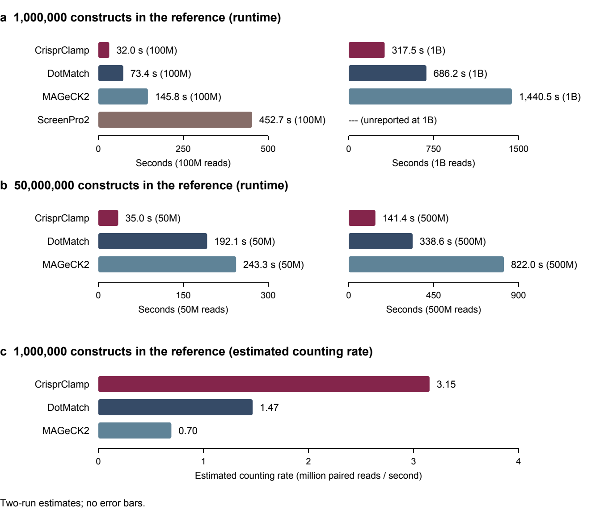

# CrisprClamp

CrisprClamp counts guide sequences and ordered guide pairs from FASTQ input for
CRISPR screens, including paired-end dual-guide screens. It reports raw counts
and read classes for downstream analysis.

## Documentation

- [Project manuscript](docs/CrisprClamp_manuscript.pdf): design, validation, and performance results.
- [User manual](docs/CrisprClamp_User_Manual.pdf): installation, input preparation, and usage.
- [Tiny example dataset](examples/tiny_dataset/README.md): input files and expected results.

## What CrisprClamp does

- Reads gzip-compressed and uncompressed FASTQ input.
- Matches guide sequences exactly and preserves Guide A and Guide B positions in ordered pairs.
- Reports every reference construct in reference order, including zero counts.
- Classifies read pairs as mapped, unmapped, invalid, ambiguous, or recombinant.
- Checks modeled memory against a user-configured planning budget before reading input.

## What it does not do

CrisprClamp does not perform downstream statistical inference, hit calling, or
biological interpretation. The public repository provides the CLI; it does not
include the SwiftUI app.

The memory budget is a planning check, not a hard limit on resident memory.
Larger workloads can use prepared reference shards and the reads assigned to
each shard; CrisprClamp does not automatically partition arbitrary mixed reads
across those shards.

## Performance

In tests on one Apple M4 Pro workstation, CrisprClamp was faster than the other
guide-counting tools compared on the tested datasets. Figure 2 from the
[project manuscript](docs/CrisprClamp_manuscript.pdf) shows measured workflow
runtimes for synthetic workloads with 1 million or 50 million reference
constructs and 50 million to 1 billion paired reads.



Panels A and B show measured workflow runtimes. Panel C uses two-run estimates
and has no error bars: the estimated counting rate is the difference in input
paired reads divided by the difference in workflow times, using two depths with
the 1-million-construct reference. These are workflow estimates rather than
isolated measurements of the counting stage. ScreenPro2 was measured at one
depth only and is omitted from Panel C. The two 50-million-construct inputs
differ in compression, so no counting rate or fixed cost is estimated for that
reference.

CrisprClamp also counted a synthetic workload of 10 billion paired reads across
1 billion distinct ordered constructs, run as 20 shards, in 47.7 minutes of
summed execution time on the same workstation.

Each tool-dataset runtime represents one measured run after warmup on a single
system. The results apply to these workloads and this Apple M4 Pro workstation;
performance on other inputs or systems may differ. See the project manuscript
for benchmark methods and limitations.

## Requirements

Apple Silicon macOS is the only tested platform. Install a Rust toolchain with
Rust 2024 edition support and the macOS command line developer tools. Python 3
is required for the example table export.

Tested with Rust 1.98.0.

## Installation

Build from source. Run from the repository root:

```sh
cargo build --release --locked
```

Shortened build output:

```text
Finished `release` profile [optimized] target(s)
```

## Quick start

Use a new output directory for each run:

```sh
./target/release/crisprclamp --mode dual --sample sample_tiny \
  --fastq examples/tiny_dataset/R1.fastq.gz \
  --fastq-r2 examples/tiny_dataset/R2.fastq.gz \
  --guides-a examples/tiny_dataset/guides_a.tsv \
  --guides-b examples/tiny_dataset/guides_b.tsv \
  --constructs examples/tiny_dataset/constructs.tsv \
  --a-start 0 --b-start 0 --b-source R2 \
  --memory-budget-bytes 2147483648 --output ./tiny_output
python3 examples/tiny_dataset/export_table.py \
  --constructs examples/tiny_dataset/constructs.tsv \
  --jsonl tiny_output/raw-counts.jsonl --output counts.tsv
cat counts.tsv
```

The counting command prints resource and timing diagnostics. The export and
print commands produce:

```text
Exported 5 rows to counts.tsv
construct_id	guide_a	guide_b	count
C01	G01	H01	2
C02	G02	H02	1
C03	G03	H03	0
C04	G04	H04	0
C05	G05	H05	0
```

## Inputs and outputs

The quick start uses paired FASTQ files and three headerless, tab-separated
reference tables:

| Input | Columns |
| --- | --- |
| Guide A table | Guide ID, nucleotide sequence |
| Guide B table | Guide ID, nucleotide sequence |
| Construct table | Construct ID, Guide A ID, Guide B ID |

Guide sequences within each guide table must have the same length. Set the
zero-based extraction positions with `--a-start` and `--b-start`; `--b-source R2`
extracts Guide B from read 2. The [user manual](docs/CrisprClamp_User_Manual.pdf)
explains how to prepare inputs and choose these settings.

For the quick-start workflow, the output directory contains:

| Output | Contents |
| --- | --- |
| `raw-counts.jsonl` | Counts in reference order, including zero-count constructs |
| `sample-qc.jsonl` | Read-class summary and totals |
| `terminal-totals.jsonl` | Detailed classification totals |
| `discovery.jsonl` | Observed sequences from unmapped read pairs |
| `run-metadata.jsonl` | Run parameters and execution metadata |
| `completion.jsonl` | Successful completion receipt |

The included export script converts the raw counts to `counts.tsv`, as shown
above. See the [tiny example dataset](examples/tiny_dataset/README.md) for the
expected counts and read classes.

## Citation

Yap, Yoon Sing. CrisprClamp, version 0.1.0. GitHub repository, 2026.

The [project manuscript](docs/CrisprClamp_manuscript.pdf) describes the method
and its evaluation.

## License and support

Copyright 2026 Yoon Sing Yap. Licensed under MIT OR Apache-2.0, at your option.
See [LICENSE-MIT](LICENSE-MIT) and [LICENSE-APACHE](LICENSE-APACHE).

For questions, bug reports, or help with larger libraries, use
[GitHub Issues](https://github.com/Yoonecorn/crisprclamp/issues).
